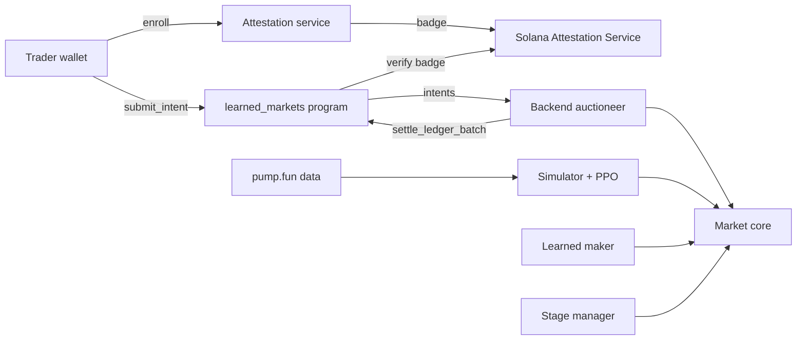

<picture>
  <source media="(prefers-color-scheme: dark)" srcset="assets/logo/damper-logo-light-text.svg">
  
</picture>

A memecoin exchange on Solana where the market's rules are learned instead of hand-picked.

On today's launchpads, money goes to whoever deploys fastest, snipes launches, or splits supply across wallets. On Damper, you make money by calling which memes catch on. It combines one wallet per person, batch auctions where arriving first doesn't help, and RL agents that run liquidity and listings inside hard on-chain limits.

Built for UBC Hackathon 2026 (DeFi and Onchain Applications, Best Use of Solana). The repo still uses our working name, `learned-markets`.

## Status

| Component | State |
| --- | --- |
| Identity registry and intent gate (Anchor) | Deployed to devnet. 33 LiteSVM tests, 26-step localnet rollout. |
| Attestation service | Run end to end on devnet with two wallets. |
| Market core, simulator | Built. One Python/PyTorch core shared by the simulator, training and backend. |
| Learned maker and stage manager | Trained with PPO and evaluated ([results](#results)). |
| Settlement (parity ledger) | Tested locally: a six-batch episode replays in LiteSVM with matching balances. Not yet on devnet. |
| Backend auctioneer | Built (FastAPI). |
| pump.fun pipeline | Built (Old Faithful → ClickHouse). |
| QuickNode Streams | Experimental. No live Stream yet. |
| Web app | Starter on `main`; mockups in [`docs/design/`](docs/design/). |

## Architecture



The simulator and the backend call the same `step_batch`, so the agents train on exactly the market they'll run, and the on-chain ledger is tested against it.

**On-chain.** Each person holds a non-transferable Token-2022 badge from the Solana Attestation Service, and the program binds them to one wallet. Every protected instruction re-checks the badge and registry. We first tried detecting wallet clusters, but attackers can always split more carefully. `settle_ledger_batch` applies a batch's fills atomically and checks that cash and tokens are conserved. An older custody design (M1) remains in the program under separate accounts.

## Economic design

1. **Batch auctions.** Everything in a batch clears at one price, so sniping doesn't pay. On an AMM, whoever lands first gets the best price.
2. **2% holding cap** per person per coin.
3. **Learned maker.** Absorbs leftover imbalance each batch and sets the exit fee, which is locked when you buy. It slows price moves but never defends a level.
4. **Public timers.** Coins stay listed while distinct traders keep them alive. At zero, the coin is delisted and its reserve goes to survivors.
5. **Stage manager.** Sets seats and the launch fee. It can't choose which coins live, since the maker holds inventory and that would be a conflict of interest.

We skipped hard lockups because unsellable coins look like honeypots. Details: [market rules](docs/ai-gen/design/market-rules.md), [board and timers](docs/ai-gen/design/board-and-timers.md), [RL formulation](docs/ai-gen/design/rl-formulation.md), [decisions log](docs/ai-gen/decisions.md).

## Results

Simulated, so directional. 64 worlds × 2,000 batches on a held-out seed. The maker trains in about 8 minutes on one RTX 5060 Ti. [Full write-up](docs/ai-gen/results/2026-11-20-evaluation.md).

| | pump.fun curve | Rule-based maker | Trained maker |
| --- | --- | --- | --- |
| Top-10 holder share | 16.1% | 7.2% | 6.8% |
| Retail profit per person (SOL) | −0.40 | −0.27 | 0.00 |
| Trapped in dead coins (SOL/world) | 386 | 140 | 209 |
| Price impact per SOL | 16 | 23 | 74 |

The trained maker beats our rule-based one on reward by about 52%, and it's fairer than pump.fun. It's also jumpier, because its reward had no smoothness term, so that's next. The stage manager beats hand-set launch rules by about 11% at normal launch rates.

## Risks

- **Maker solvency.** Fees and noise profit must cover losses to informed traders. The trained maker is currently easier to pick off than the rule-based one.
- **Identity.** Badges are operator-approved test identities, with no proof-of-personhood provider yet.
- **Delisting.** Holders of a dying coin lose their position. Public timers give warning.
- **Simulator realism.** How people react to fees and caps can't be measured from pump.fun data.
- **Regulatory.** Devnet prototype, no real funds.

## Program IDs

| Program | Network | ID |
| --- | --- | --- |
| `learned_markets` | devnet | `nuX7BMKKWz9WG6EDRn5dXnSZArRW8uLkyKC5iTenqQz` |
| Solana Attestation Service | devnet | `22zoJMtdu4tQc2PzL74ZUT7FrwgB1Udec8DdW4yw4BdG` |
| Token-2022 | devnet | `TokenzQdBNbLqP5VEhdkAS6EPFLC1PHnBqCXEpPxuEb` |

Run records are in [`docs/rollout/`](docs/rollout/).

## Layout

| Path | Contents |
| --- | --- |
| `programs/learned-markets` | Anchor program |
| `tests/program-tests` | LiteSVM suite (separate Cargo workspace) |
| `packages/core` | Market core |
| `packages/simulation`, `packages/training` | Simulator, PPO training, evaluation |
| `packages/client`, `packages/attestations` | TypeScript bindings and attestation tools |
| `apps/backend` | FastAPI auctioneer |
| `apps/attestation-service` | Enrollment and sessions |
| `apps/settler` | Earlier settlement experiment, QuickNode receiver |
| `apps/web` | Front end |
| `data/` | pump.fun pipeline |
| `fixtures/`, `scripts/` | Test vectors, demos, codegen |
| `docs/` | Specs, decisions, results, mockups |

## Run locally

Requires Rust, Solana CLI 4.4, Anchor 1.2.2, Node ≥ 24.12, Python 3.12 with uv.

```bash
npm ci && uv sync --locked --all-packages --all-extras
npm run test:programs                  # program + LiteSVM suite
npm run typecheck && npm test          # TypeScript
uv run --all-packages --all-extras pytest -p no:pytest_anchorpy \
  packages/core/tests packages/simulation/tests apps/backend/tests
uv run --package learned-markets-backend uvicorn learned_markets_backend.service:app --port 8000
npm run dev                            # web app
```

More: [development guide](docs/DEVELOPMENT.md), [attestations runbook](docs/ai-gen/attestations.md), [backend](apps/backend/README.md).
