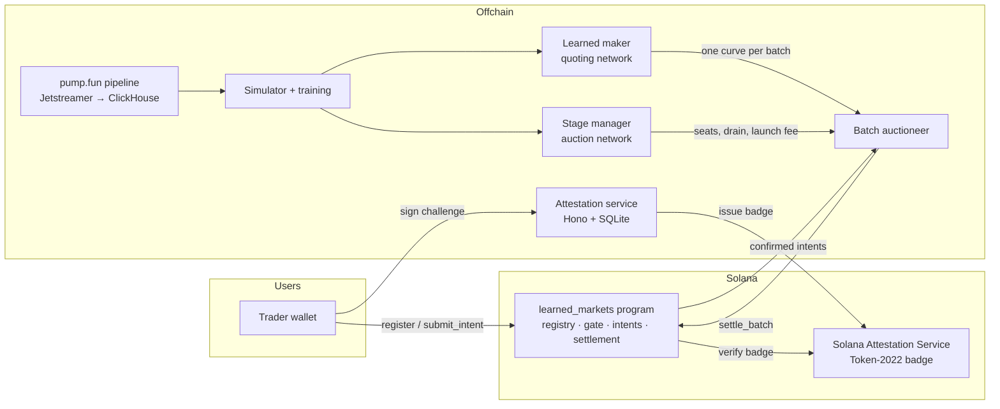

# Damper

A memecoin exchange on Solana where the market's rules are learned and tuned instead of hand-picked.

On today's launchpads, the people who make money are the ones who deploy fastest, snipe launches, or split supply across a dozen wallets. We wanted an exchange where you make money by calling which memes catch on. Damper gets there with three pieces: one wallet per person, batch auctions where arriving first doesn't help, and reinforcement-learning agents that manage liquidity and listings inside hard on-chain limits.

We built this for the UBC Hackathon 2026 (DeFi and Onchain Applications, Best Use of Solana). The repo and packages still use our working name, `learned-markets`.

## Status

We designed more than we could build in a week, so here's where each part stands:

| Component | State |
| --- | --- |
| Identity registry and trade-intent gate (Anchor program) | **Built, deployed to devnet.** 33 LiteSVM tests plus a 26-step localnet rollout. |
| Attestation service and operator CLI | **Built.** Run end to end on devnet with two browser-wallet participants. |
| pump.fun history pipeline (Old Faithful → ClickHouse) | **Built.** |
| Batch-auction settlement | **Scaffolded.** Validation runs, but execution returns `SettlementNotImplemented`. |
| Learned maker, stage manager, simulator | **Designed.** Training is next. |
| Web app | React + Vite starter. UI mockups in progress. |

## Architecture



### On-chain: `programs/learned-markets`

The program is written in Anchor 1.2.2 and stores `Config`, `Participant`, `WalletBinding` and `Intent` PDAs.

Each participant gets a non-transferable Token-2022 badge through the Solana Attestation Service, and the registry ties that participant to exactly one active wallet. We started out trying to detect wallet clusters, but switched to attestations because detection is a guessing game and attackers can always split wallets more carefully.

Every protected instruction calls `gate::require_eligible`. Holding the badge isn't enough. The gate re-checks the registry, the SAS credential, schema and signer, the badge mint and its owner, expiry against the on-chain clock, and the pause flags on every call.

`submit_intent` records a hashed curve order (up to 16 price/quantity steps) with a strict nonce and a deadline of at most five minutes. Traders can always cancel.

`settle_batch` validates every intent first: eligibility, payload hash, expiry, replays and duplicates. It then passes the intents to a settlement engine that consumes them and applies the state changes in the same instruction. Writing that engine is our next step.

| Instruction | Signer |
| --- | --- |
| `initialize_config`, `update_config` | upgrade authority / admin |
| `register_participant` | attested wallet |
| `suspend_participant`, `revoke_participant`, `replace_binding` | admin (+ new wallet for replacement) |
| `submit_intent`, `cancel_intent` | current bound wallet |
| `settle_batch` | settlement authority |

### Off-chain

- `apps/attestation-service` handles challenges, enrollment, wallet replacement, sessions and intent admission. It re-reads chain state on every privileged request and refuses the request if RPC is down.
- `packages/attestations` has the TypeScript schema codecs, verifier, gate client and the `lm-attest` operator CLI.
- `data/jetstreamer` streams Solana history from Old Faithful and keeps every pump.fun and PumpSwap create, trade, completion and migration. We'll train and evaluate the agents on this data.
- `packages/simulation` and `packages/training` are the Python workspace for the market simulator and the RL agents (Gymnasium, Stable-Baselines3).

## Economic design

1. **Batch auctions with curve orders.** Every order is a supply or demand curve, and everything in a batch clears at one price. We picked this over an AMM because on an AMM, whoever lands first gets the best price, which is exactly the sniping problem.
2. **Learned maker.** One agent posts a single curve per batch and only absorbs whatever imbalance is left after traders net against each other. It slows price moves but never defends a price level, since defended levels are what attackers target.
3. **Board and public timers.** New coins start in a low-stakes line. Each coin on the board has a countdown fed by fees from distinct traders. Each person's fees count by their square root, so ten small traders outweigh one whale. When a timer hits zero, the coin is delisted and its reserve goes to the coins that survived.
4. **Stage manager.** A second agent sets the number of seats, the drain rate, the timer cap and a launch fee that goes up when lots of people are launching. We deliberately didn't let it pick which coins live. The maker holds inventory, so letting the agents decide survival would be a conflict of interest.
5. **Fees and holds.** `fee = base + sell-speed term + decaying exit fee`. You can always sell, but it costs more right after buying. We dropped hard lockups early on because a coin you can't sell looks like a honeypot. Holds also release once a coin's timer is close to running out.

Full specs: [market rules](docs/ai-gen/design/market-rules.md), [board and timers](docs/ai-gen/design/board-and-timers.md), [RL formulation](docs/ai-gen/design/rl-formulation.md). Every decision we made or rejected, with the reason, is in the [decisions log](docs/ai-gen/decisions.md).

## Risk assumptions

- **Maker solvency.** The maker stays solvent only as long as profit from noise trading plus its share of fees covers what it loses to informed and adversarial traders. Hard on-chain caps limit the damage: a loss budget per epoch, an inventory limit, a maximum share of volume and a kill switch.
- **Identity.** Badges are currently operator-approved test identities. We haven't integrated a real proof-of-personhood provider, and an approved person could still script their own wallet.
- **Delisting.** If you're holding a coin when it dies, you lose that position. Public timers and released holds are there so you can see it coming and get out.
- **Sim-to-chain gap.** The simulator and the program have to use identical clearing math. We enforce that with golden test vectors shared between Python and Rust.
- **Regulatory.** Fee sharing and token launches can raise securities questions. This is a devnet prototype with no real funds.

## Solana usage and program IDs

| Program | Network | ID |
| --- | --- | --- |
| `learned_markets` | devnet, localnet | `nuX7BMKKWz9WG6EDRn5dXnSZArRW8uLkyKC5iTenqQz` |
| `gate_test_consumer` (CPI test only) | localnet | `ZwKZ5pjQuiEr6AbHCj4BibaCLfyagQj8Ye4nfHRRx4q` |
| Solana Attestation Service | devnet | existing SAS program |
| Token-2022 | devnet | existing SPL program |

Run records with transaction signatures are in [`docs/rollout/`](docs/rollout/).

## Repository layout

| Path | Contents |
| --- | --- |
| `programs/learned-markets` | Anchor program: registry, gate, intents, settlement boundary, accounting helpers |
| `programs/gate-test-consumer` | Test-only CPI caller |
| `tests/program-tests` | LiteSVM suite against the real SAS binary (separate Cargo workspace) |
| `packages/attestations` | TypeScript codecs, verifier, operator CLI |
| `packages/client` | Shared TypeScript SDK (planned) |
| `packages/simulation`, `packages/training` | Python simulator and RL training |
| `apps/attestation-service` | HTTP service for enrollment, sessions and intent admission |
| `apps/web` | React + Vite front end |
| `data/jetstreamer` | pump.fun extraction pipeline |
| `fixtures/` | Shared cross-language test vectors |
| `scripts/` | Rollout and two-user devnet demo |

## Run locally

You'll need Rust (via rustup), Solana CLI 4.4, Anchor CLI 1.2.2, Node ≥ 24.12, and Python 3.12 with uv.

```bash
npm ci
anchor build                     # program + IDL
npm run test:programs            # Rust unit tests + LiteSVM on-chain suite
npm run typecheck && npm test    # TypeScript packages and service
npm run dev                      # web app at http://localhost:5173
```

Two-user devnet demo, where two participants enroll, get approved, and submit gated intents from their own wallets:

```bash
# terminal 1: attestation service
DB_PATH=attestation-service.devnet.sqlite LM_RPC_URL=https://api.devnet.solana.com \
  node apps/attestation-service/src/main.ts

# terminal 2: demo clients
DB_PATH=attestation-service.devnet.sqlite LM_RPC_URL=https://api.devnet.solana.com \
  node scripts/two-user-client-demo.ts
```

More detail: [development guide](docs/DEVELOPMENT.md), [attestations runbook](docs/ai-gen/attestations.md), [on-chain validation](docs/ai-gen/onchain-validation.md).
